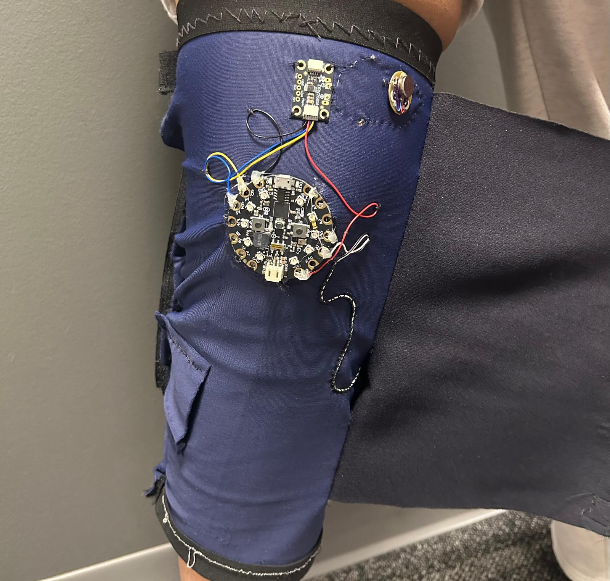
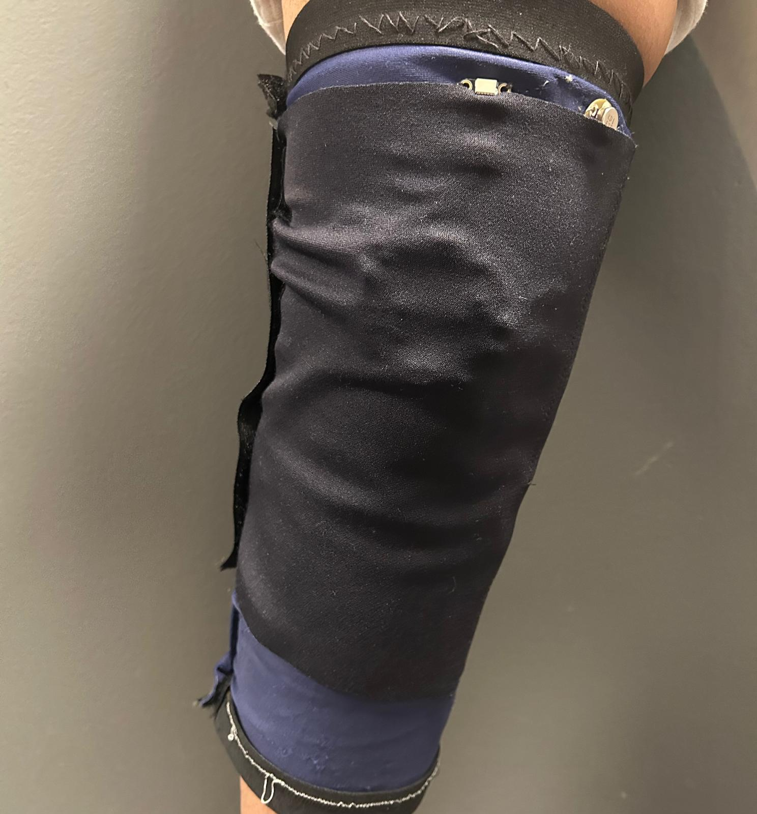

# Parkinson's Freezing of Gait Detection Wearable

Developed at MIT Beaver Works Summer Institute (BWSI) 2026.

## Project Overview
Designed and built an e-textile knee sleeve that uses an accelerometer and flex sensor to detect simulated Parkinson's Freezing of Gait (FoG) patterns and provide vibration-based haptic feedback.

<h2>Final Prototype</h2>

<strong>Electronics Integration</strong>

<strong>Completed Wearable</strong>

## Hardware
- Adafruit Circuit Playground Express (SAMD21)
- Flex sensor
- Adafruit DRV2605L haptic driver
- LilyPad Vibe Board
- Battery
- Custom-sewn knee sleeve

## Detection Algorithm
The system measures leg acceleration and knee bending to identify rapid movement patterns associated with trembling-type FoG.

It uses accelerometer zero-crossings, flex-sensor slope changes, noise filtering, and a 1.5-second voting window to combine sensor readings before activating vibration feedback.

## Testing
Tested the sensors during standing, normal walking, and simulated FoG movements to adjust detection thresholds and reduce false positives.

This is an experimental prototype and has not been clinically validated.
